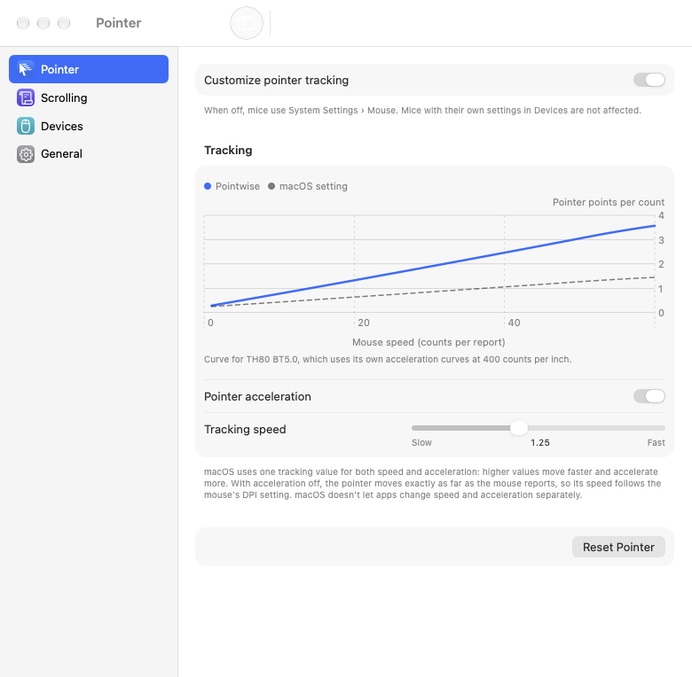
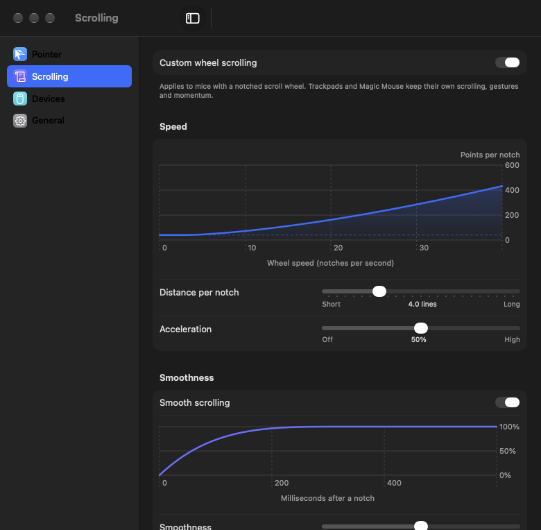

<p align="center">
  
</p>

<h1 align="center">Pointwise</h1>

<p align="center">
  Fine-tune your mouse on macOS — pointer speed, acceleration and wheel scrolling —<br>
  without touching the trackpad.
</p>

<p align="center">
  <a href="https://github.com/devleloper/Pointwise/actions/workflows/ci.yml"></a>
  
  
  <a href="LICENSE"></a>
</p>

---

Pointwise is a small native menu bar app for people who use a mouse with their Mac. It sets pointer tracking per mouse, replaces the macOS wheel behaviour with a configurable speed curve and smooth glide, and reverses scrolling per axis — while your trackpad, its gestures and its momentum stay exactly as macOS made them. It uses only public macOS APIs and works fully offline.

<p align="center">
  
  &nbsp;
  
</p>

## Features

- **Pointer tracking per mouse.** Set speed and acceleration for all mice at once, or give a single mouse its own settings. Pointwise applies them through the same HID property System Settings uses, so there is no added latency and games and drawing apps keep working.
- **Acceleration off.** One switch turns pointer acceleration off: the pointer moves exactly as far as the mouse reports.
- **The real curve.** Pointer settings show the acceleration curve macOS actually applies to *your* mouse, computed from the curves or table the device publishes, compared with your macOS setting.
- **Wheel speed curve.** Distance per notch plus acceleration for fast spins, drawn as you adjust it. Slow, deliberate scrolling is never accelerated.
- **Smooth scrolling.** Each notch glides to a stop. Smoothness sets the glide length, responsiveness how much happens immediately. Clicking or touching the trackpad stops the glide.
- **Independent reversal.** Reverse vertical and horizontal wheel scrolling separately, without changing the trackpad's Natural scrolling.
- **Trackpad untouched.** Trackpad and Magic Mouse events, with their gestures, rubber-banding and momentum, always pass through unchanged.
- **Devices.** Mice appear and disappear as you connect them (USB, Bluetooth, wireless receivers). Settings for disconnected mice are kept.
- **Safe.** Every change applies immediately and is saved. Quitting, pausing or "Restore Defaults" hands every mouse back to its macOS settings. Pointwise re-applies its values if macOS resets them (after sleep, reconnecting, or a System Settings change).
- **Native and light.** SwiftUI with Light and Dark Mode, English and Russian. Idle CPU usage is 0%; the event tap only sees scroll-wheel events.
- **Private.** No network code, no telemetry, no analytics. The keyboard is never observed.

## What macOS allows, and what it doesn't

Pointwise uses public APIs only. Some things popular mouse utilities do require private APIs, so Pointwise deliberately doesn't do them:

| Wish | Status | Why |
| --- | --- | --- |
| Pointer speed and acceleration | ✅ | `HIDMouseAcceleration` per device via `IOHIDServiceClient` |
| Turn pointer acceleration off | ✅ | A negative tracking value makes macOS pass raw mouse counts |
| **Separate** speed and acceleration sliders, custom pointer curve shapes | ❌ | macOS couples them in one tracking value; pointer resolution and curves are writable only by privileged (private-API) clients. Pointwise shows you the real curve instead. |
| Per-device **scrolling** settings | ❌ | Telling which mouse scrolled needs a private API or Input Monitoring access. Scrolling settings apply to every wheel mouse. |
| Change trackpad behaviour | — | Out of scope by design; macOS handles it. |

Details in the [FAQ](#faq) and [docs/ARCHITECTURE.md](docs/ARCHITECTURE.md).

## Requirements

- macOS 14 Sonoma or later, Apple silicon or Intel
- A mouse (USB, Bluetooth or a wireless receiver)
- Building from source: Xcode 16 or later

## Installation

### Download

1. Download `Pointwise-x.y.z.dmg` from [Releases](https://github.com/devleloper/Pointwise/releases).
2. Open it and drag **Pointwise** to **Applications**.
3. Open Pointwise from Applications. Releases are signed with a Developer ID and notarized by Apple.

### Build from source

```bash
git clone https://github.com/devleloper/Pointwise.git
cd Pointwise
./scripts/build-release.sh
```

The app is written to `build/DerivedData/Build/Products/Release/Pointwise.app` (ad-hoc signed, for your own Mac). See [docs/BUILDING.md](docs/BUILDING.md).

## Usage

1. Launch Pointwise. The welcome screen explains what it does.
2. **Pointer:** turn on **Customize pointer tracking**, then move **Tracking speed** or switch **Pointer acceleration** off. No permission is needed.
3. **Scrolling:** click **Grant Access…** and allow Pointwise under **Privacy & Security › Accessibility**. Pointwise picks up the change by itself. Then adjust the speed curve and glide, or reverse an axis.
4. **Devices:** choose **Custom** for a mouse that should behave differently, or **macOS settings** to leave it alone.

The menu bar item pauses Pointwise or toggles smooth scrolling in one click. Full guide: [docs/USER_GUIDE.md](docs/USER_GUIDE.md).

## Permissions

| Feature | Permission |
| --- | --- |
| Pointer speed and acceleration | None |
| Wheel scrolling (curve, glide, reversal) | Accessibility |
| Open at login | Approved by you in Login Items |

Pointwise never asks for Input Monitoring, Screen Recording or network access. What Accessibility is used for: [docs/PERMISSIONS.md](docs/PERMISSIONS.md).

## Privacy

- No network code at all: no update checks, telemetry or crash reporting.
- The event tap receives **scroll-wheel events only**. Keystrokes, clicks and pointer movement never pass through Pointwise.
- To stop a glide when you click, Pointwise uses a passive click monitor that only notes *that* a button was pressed.
- Settings live in `~/Library/Preferences/io.github.devleloper.Pointwise.plist`.

## FAQ

**Why can't I set speed and acceleration separately, like in LinearMouse?**
macOS has a single tracking value per device that selects one of the device's acceleration curves; higher values are both faster and more accelerated. Changing pointer resolution (which LinearMouse uses for speed) needs a private HID client. With acceleration off, the speed follows your mouse's DPI setting — most gaming mice let you change it in hardware.

**Why is my scrolling setting the same for all my mice?**
macOS doesn't tell apps which device produced a scroll event through public API without Input Monitoring access, which also covers the keyboard. Pointwise doesn't ask for it.

**Does it work with Logitech, Razer, generic and Bluetooth mice?**
Yes — any mouse macOS sees as a HID mouse. If a vendor tool (Logi Options+, Razer Synapse, SteerMouse) also changes tracking or scrolling, turn the overlapping feature off in one of them; two tools fighting over the same setting cause jumps.

**Does it change my Magic Mouse or trackpad?**
The trackpad, never. Magic Mouse scrolling is gesture-based like the trackpad's and always passes through untouched; if macOS reports Magic Mouse as a mouse for tracking, it appears in Devices like any other mouse.

**Scrolling feels too fast in Java apps (JetBrains IDEs).**
Java rounds every pixel-precise scroll event up to one unit. Turn off **Smooth scrolling** while working in such apps; the speed curve and reversal still work.

**What happens if Pointwise crashes?**
Scroll events go back to normal immediately. Tracking values stay as they were until the mouse reconnects, you log out, or you change the speed in System Settings.

**Can I use it together with Mac Mouse Fix or LinearMouse?**
Not for the same features. Disable either the pointer or the scrolling part in one of them.

More in [docs/TROUBLESHOOTING.md](docs/TROUBLESHOOTING.md).

## Documentation

- [User guide](docs/USER_GUIDE.md)
- [Permissions](docs/PERMISSIONS.md)
- [Troubleshooting](docs/TROUBLESHOOTING.md)
- [Architecture](docs/ARCHITECTURE.md)
- [Building](docs/BUILDING.md) · [Releasing](docs/RELEASING.md)
- [Contributing](CONTRIBUTING.md) · [Code of Conduct](CODE_OF_CONDUCT.md) · [Security](SECURITY.md) · [Changelog](CHANGELOG.md)

## Acknowledgements

- [LinearMouse](https://github.com/linearmouse/linearmouse) and [Mac Mouse Fix](https://github.com/noah-nuebling/mac-mouse-fix) showed what a good mouse utility feels like. Pointwise shares no code with them.
- The curve visualization reproduces the behaviour of Apple's open-source [IOHIDFamily](https://github.com/apple-oss-distributions/IOHIDFamily) (Apple Public Source License 2.0), including its default acceleration table.

## License

[MIT](LICENSE) © 2026 Devlet Boltaev
